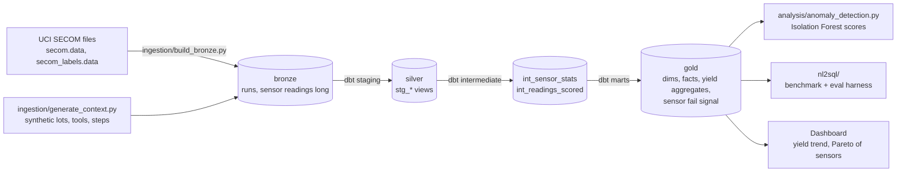

# Semiconductor Yield & Test Analytics (SECOM)

> A governed lakehouse for semiconductor manufacturing test data: from raw sensor readings to trusted yield metrics, anomaly detection and plain-English questions answered with evaluated SQL.

**Author:** Stanley Igwe, Lead Data (Analytics) Engineer (BEng/MSc Electrical & Electronic Engineering) · [Portfolio](https://saigwe.github.io)
**Stack:** Python · dbt Core · DuckDB (local and CI) · Databricks + Delta Lake (cloud) · scikit-learn · GitHub Actions
**Status:** 🚧 Scaffolded. See [Roadmap](#roadmap).

---

## 90-second summary
| | |
|---|---|
| **Problem** | Fabs log hundreds of sensor readings per wafer, but yield engineers can't easily tell which signals precede failures, and dashboards built on raw tables disagree with each other. |
| **What I built** | A bronze → silver → gold model with a clear grain at every layer, yield metrics defined once, statistical out-of-control flags, failure-signal ranking, an anomaly model, and a natural-language-to-SQL layer tested against a gold benchmark. |
| **Why it matters** | Engineers get **one trusted yield number**, a ranked list of **suspect sensors**, and can ask questions in plain English **without silently wrong answers**. |
| **Proof** | See [Numbers](#numbers). Every claim there is reproducible with `make all`. |

## Architecture

- **Local and CI:** DuckDB file `warehouse/bt2.duckdb`.
- **Cloud:** the same dbt models run on Databricks with the `databricks` target, materialised as **Delta tables**. Model SQL avoids dialect-specific functions so both targets work.

## Data model (gold layer)
| Model | Grain | Purpose |
|---|---|---|
| `dim_wafer` | one row per wafer (= one SECOM run) | wafer → lot mapping |
| `dim_lot` | one row per lot | lot size, start time |
| `dim_sensor` | one row per sensor | process step, tool, parameter, missing rate, constant-sensor flag |
| `dim_tool` / `dim_process_step` | one row per tool / step | context |
| `fct_wafer_test` | one row per wafer test run | pass/fail, timestamp, data-completeness and out-of-control counts |
| `fct_sensor_reading` | one row per wafer × sensor | value, z-score, out-of-control flag |
| `agg_yield_daily` / `agg_yield_by_lot` | day / lot | **the** yield metric (defined once) |
| `rpt_sensor_fail_signal` | one row per sensor | pass vs fail mean shift (effect size) → ranked suspects |

The full layer plan is in [`docs/layer_plan.md`](docs/layer_plan.md). Design decisions and trade-offs are in [`docs/design_doc.md`](docs/design_doc.md).

## Data quality: catching "technically valid but semantically wrong" outputs
- Generic tests: `unique`, `not_null`, `relationships`, `accepted_values` on every primary or foreign key.
- Business-rule tests (`tests/`):
  - yield is between 0 and 1, and fails never exceed wafers
  - every wafer has sensor readings
  - every lot's wafer count matches `dim_lot`
  - no test timestamp is later than the load time
- Constant and mostly-missing sensors are **flagged, not silently dropped**, so analysts see why a sensor is excluded.

## Numbers
*(Fill these from real runs. Never estimate.)*
| Metric | Value |
|---|---|
| Wafer runs / sensors / readings | 1,567 / 590 / ~925k |
| Overall yield | _tbd_ |
| dbt models / tests | _tbd_ / _tbd_ |
| `dbt build` runtime (DuckDB, laptop) | _tbd_ |
| `dbt build` runtime (Databricks Free Edition) | _tbd_ |
| Anomaly model: precision@k on held-out fails | _tbd_ |
| NL-to-SQL execution accuracy (gold benchmark, n questions) | _tbd_ |

## How to run
Requires **Python 3.12** (dbt doesn't support every new Python release immediately), `make` (or run the commands inside the `Makefile` by hand), and internet access for the dataset download.
```bash
python -m venv .venv && source .venv/bin/activate   # Windows: .venv\Scripts\activate
pip install -r requirements.txt
make all          # download SECOM -> bronze -> dbt build -> anomaly scores
make fixture-all  # same pipeline on a small synthetic fixture (no download; used in CI)
```
Databricks: set `DATABRICKS_HOST`, `DATABRICKS_HTTP_PATH` and `DATABRICKS_TOKEN`. Load bronze with `ingestion/databricks_load_bronze.py`, then run `dbt build --target databricks`.

## Roadmap
- [x] Repo scaffold, layer plan, design doc template, dbt models and tests, fixture-based CI. Fixture run: `dbt build` 72/72 passing; the fail-signal report ranks the two injected shifted sensors first; NL-to-SQL guardrail and benchmark harness pass the self-check.
- [ ] Run on real SECOM data and fill in [Numbers](#numbers)
- [ ] Databricks Free Edition run (Delta, bronze/silver/gold schemas), with runtime and cost notes
- [ ] Anomaly model evaluation (precision@k, time-based split)
- [ ] NL-to-SQL agent restricted to gold models, plus benchmark results
- [ ] Dashboard (yield trend, sensor Pareto) and a 3-minute Loom walkthrough ([script ready](docs/walkthrough.md))

## Data and licence
- **SECOM:** McCann, M. & Johnston, A. (2008). *SECOM* [Dataset]. UCI Machine Learning Repository. https://doi.org/10.24432/C54305. Licensed **CC BY 4.0**.
- **Synthetic context:** lots, tools, process steps and sensor names are **synthetic**. They are generated with a fixed seed by `ingestion/generate_context.py` because SECOM is anonymised. They're for modelling demonstration only and don't describe any real fab.
- **Code:** MIT (see `LICENSE`).
