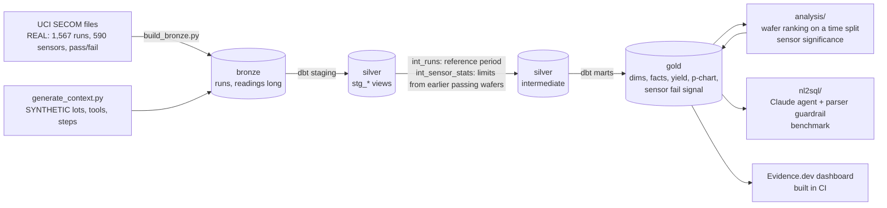

# Semiconductor Yield & Test Analytics (SECOM)

> A governed lakehouse for semiconductor manufacturing test data: from raw sensor readings to trusted yield metrics, anomaly detection and plain-English questions answered with evaluated SQL.

**Author:** Stanley Igwe, Lead Data (Analytics) Engineer (BEng/MSc Electrical & Electronic Engineering) · [Portfolio](https://saigwe.github.io)
**Stack:** Python · dbt Core · DuckDB (local and CI) · Databricks + Delta Lake (cloud target) · scikit-learn · SciPy · Claude API · Evidence.dev · GitHub Actions
**Status:** ✅ Built on the real SECOM data: `dbt build` 82/82, pytest 33/33, CI green. The Databricks run and the live Claude benchmark run need credentials and are next.
**Dashboard:** [saigwe.github.io/reports/semiconductor-yield](https://saigwe.github.io/reports/semiconductor-yield/) (Evidence.dev)

---

## 90-second summary
| | |
|---|---|
| **Problem** | Fabs log hundreds of sensor readings per wafer, but yield engineers can't easily tell which signals precede failures, control limits go stale, and dashboards built on raw tables disagree with each other. |
| **What I built** | A bronze → silver → gold model of UCI's real SECOM data (1,567 wafers × 590 sensors) with one yield definition, a daily p-chart, control limits set only from earlier passing wafers, a sensor ranking with multiple-testing checks, a wafer ranking scored on later, unseen wafers, and a Claude NL-to-SQL agent behind a parser-based guardrail. |
| **Why it matters** | Engineers get **one trusted yield number**, a short list of sensors that **beat chance**, a wafer ranking that's honest about what works, and plain-English questions that **can't escape the gold layer**. |
| **Proof** | Only 3 of 440 sensors pass both noise checks. On the later half of wafers, walk-forward gradient boosting reaches **3x the base rate** in average precision, while a one-off fit does no better than chance. The guardrail blocks **20/20 attacks**; the regex it replaced let 6 through. See [Numbers](#numbers). |

## Architecture

- **Local and CI:** DuckDB file `warehouse/bt2.duckdb`.
- **Cloud:** the same dbt models target Databricks with the `databricks` target, materialised as Delta tables. Model SQL avoids dialect-specific functions except the timestamp parser, which is a dispatched macro. Not yet run there: it needs workspace credentials.

## Data
| Source | What | Licence | Real or synthetic |
|---|---|---|---|
| [UCI SECOM](https://doi.org/10.24432/C54305) | 1,567 wafer test runs, 19 Jul – 17 Oct 2008: 590 anonymised sensor readings each, pass/fail and timestamp | CC BY 4.0 | **Real** |
| `ingestion/generate_context.py` | 63 lots of 25 wafers in test order, 6 process steps, 18 tools, sensor names | Mine | **Synthetic** (SECOM is anonymised) |

Runs are in time order in the file (0 out of order, 33 ties), so the first half by test time is the reference period: 784 wafers with 67 fails. The later 783 wafers (37 fails) are the test set for every ranking method.

## Data model (gold layer)
| Model | Grain | Purpose |
|---|---|---|
| `dim_wafer`, `dim_lot`, `dim_sensor`, `dim_tool`, `dim_process_step` | one row per entity | Context; `dim_sensor` flags constant and mostly-missing sensors instead of dropping them |
| `fct_wafer_test` | wafer test run | Pass/fail, time order, reference-period flag, missing and out-of-control counts |
| `fct_sensor_reading` | wafer × sensor | Value, z-score against reference-period limits, out-of-control flag |
| `agg_yield_daily` / `agg_yield_by_lot` | day / lot | **The** yield metric, defined once |
| `rpt_yield_p_chart` | day | Daily fail rate with 3-sigma limits from the reference period |
| `rpt_sensor_fail_signal` | sensor | Cohen's d between failing and passing wafers, ranked |
| `ml_sensor_signal_significance` | sensor | Benjamini-Hochberg q value and the label-shuffle check (Python) |
| `ml_wafer_anomaly_scores` | wafer | Ranking scores for the main methods (Python) |

The layer plan is in [`docs/layer_plan.md`](docs/layer_plan.md); decisions and trade-offs are in [`docs/design_doc.md`](docs/design_doc.md).

## Tests
- **Keys and values:** `unique`, `not_null`, `relationships` and `accepted_values` on every primary and foreign key.
- **Business rules:** yield in [0, 1]; fails never exceed wafers; every wafer has readings; lot counts match; no test timestamp after load; p-chart limits bracket the centre line.
- **Unit test:** `control_limits_use_only_reference_passing_wafers`. Failing wafers and wafers after the reference period must not move a sensor's limits.
- **pytest (33):** all 28 guardrail cases; the execution connection can't read files; the agent corrects itself after a guardrail rejection, passes refusals through and gives up after three bad queries (scripted Claude replies, no API call); ranking helpers.
- **Benchmark self-check:** all 30 gold SQL answers pass the guardrail and run.

## Numbers
All from `make all` on the real SECOM files, 26 Oct 2026, on a Windows laptop.

| Pipeline | Value |
|---|---|
| Wafer runs / sensors / readings | 1,567 / 590 / 924,530 (4.5% missing) |
| Usable sensors | 440 (122 constant in the reference period, 28 missing in more than half of wafers) |
| dbt | 20 models, 61 data tests, 1 unit test: 82/82 pass in 2.4 s |
| Load (download, bronze, context) | 5 s |
| Ranking evaluation (10 methods, 1,000 bootstraps each) | about 4 minutes |

**Yield and process control (real pass/fail)**

| Metric | Value |
|---|---|
| Overall yield | 93.4% (104 fails) |
| Yield by month | Jul 77.8% · Aug 90.8% · Sep 97.1% · Oct 93.9% |
| p-chart centre line (reference fail rate) | 8.5% |
| Days above the upper limit | 4 of 86 (25 Jul, 29 Jul, 10 Aug, 17 Aug) |
| Out-of-control readings per passing wafer | 4.4 in the reference period vs 10.9 later: the process drifted |

**Which sensors separate failing wafers?** ([`results/fail_signal.md`](results/fail_signal.md))

| Check | Sensors passing |
|---|---:|
| Benjamini-Hochberg false discovery rate, 5% | 22 |
| Above the 95th percentile of the largest \|d\| with shuffled labels (500 shuffles) | 5 |
| **Both** | **3** (sensors 60, 104, 511) |

The strongest is sensor 60 (d = 0.63). Several sensors ranked in the top 15 by effect size don't pass the false-discovery check, so the top-10 list alone would mislead.

**Which wafers to inspect first?** ([`results/anomaly_eval.md`](results/anomaly_eval.md)) Fitted on the first 784 wafers, scored on the later 783 (37 fails, base rate 4.7%). Every variant tried is listed.

| Method | Avg precision (95% CI) | ROC AUC (95% CI) | Fails in top 10% |
|---|---|---|---:|
| Random | 0.042 (0.029–0.070) | 0.437 (0.345–0.530) | 5% |
| Static SPC count (reference limits) | 0.049 (0.032–0.083) | 0.474 (0.377–0.568) | 11% |
| Isolation Forest, one fit on passing wafers | 0.057 (0.036–0.097) | 0.528 (0.422–0.629) | 11% |
| Logistic regression, one fit | 0.054 (0.039–0.079) | 0.573 (0.499–0.654) | 8% |
| Rolling robust SPC, 100 / 200 / 400 wafers | 0.065 / 0.067 / 0.071 | 0.552 / 0.552 / 0.583 | 11% / 19% / 22% |
| Walk-forward logistic regression | 0.097 (0.049–0.178) | 0.616 (0.526–0.702) | 16% |
| **Walk-forward gradient boosting** | **0.147 (0.080–0.263)** | **0.664 (0.571–0.757)** | **27%** |
| Walk-forward Isolation Forest | 0.050 (0.033–0.078) | 0.524 (0.432–0.617) | 8% |

Models fitted once on the first half do no better than chance on the second, because the process drifted. Refitting every 100 wafers on everything tested so far is what works. Walk-forward gradient boosting puts 3 fails in its top 10 wafers and 10 of 37 in its top 10%, about 3x random. It is a triage aid for engineers, not a pass/fail predictor.

**NL-to-SQL** ([`results/guardrail.md`](results/guardrail.md))

| Metric | Value |
|---|---|
| Guardrail adversarial suite (20 attacks, 8 legitimate) | Parser: **28/28**. Legacy regex: 21/28 (let 6 attacks through, blocked 1 legitimate query) |
| Attacks the regex missed | comma joins to bronze and silver, a raw file path, `getenv`, `current_setting`, `read_text` |
| Benchmark | 30 questions with hand-written gold SQL + 6 that must be refused; self-check 30/30 |
| Claude agent execution accuracy | _not run yet: needs Anthropic credentials (`make agent-eval`)_ |
| Databricks Free Edition runtime | _not run yet: needs workspace credentials_ |

## Dashboard
[saigwe.github.io/reports/semiconductor-yield](https://saigwe.github.io/reports/semiconductor-yield/) shows the KPIs, the p-chart, the lowest-yield lots, the sensor Pareto coloured by statistical evidence, the drift chart, the ranking comparison and the guardrail results. It reads small CSV exports of the gold tables (`reports/sources/secom`, written by `make report-data`), so CI builds it without downloading SECOM. On every push to `main`, CI publishes the build to this repo's `report-site` branch.

## How to run
Requires **Python 3.12** (what CI uses) and `make`, or run the commands in the `Makefile` by hand.
```bash
python -m venv .venv && source .venv/bin/activate   # Windows: .venv\Scripts\activate
pip install -r requirements.txt
make all          # download SECOM -> bronze -> context -> dbt build -> analysis -> guardrail + benchmark -> report CSVs
make fixture-all  # same pipeline on a small synthetic fixture, plus pytest (CI)
make agent-eval   # the Claude agent on the benchmark (needs ANTHROPIC_API_KEY or an `ant auth login` profile)
cd reports && npm install && npm run sources && npm run dev   # the dashboard (Node 18+)
```
Databricks: set `DATABRICKS_HOST`, `DATABRICKS_HTTP_PATH` and `DATABRICKS_TOKEN`. Load bronze with `ingestion/databricks_load_bronze.py`, then run `dbt build --target databricks`.

The agent uses `claude-opus-5-5` (override with `NL2SQL_MODEL`) with the API's server-side refusal fallback turned on.

## Roadmap
- [x] Repo scaffold, layer plan, design doc, dbt models and tests, fixture-based CI
- [x] Run on real SECOM data and fill in [Numbers](#numbers)
- [x] Control limits from a reference period (unit-tested), daily p-chart, sensor ranking with false-discovery and label-shuffle checks
- [x] Anomaly model evaluation: precision@k, ROC AUC and average precision with bootstrap intervals, on a time split
- [x] NL-to-SQL agent restricted to gold models: parser-based guardrail (28/28 adversarial cases), 36-item benchmark, agent loop tested with scripted replies
- [ ] Run the Claude agent on the benchmark and publish execution accuracy (needs Anthropic credentials)
- [ ] Databricks Free Edition run (Delta, bronze/silver/gold schemas), with runtime and cost notes (needs workspace credentials)
- [x] Dashboard (yield trend, sensor Pareto) on Evidence.dev
- [ ] 3-minute Loom walkthrough ([script ready](docs/walkthrough.md))

## Data and licence
- **SECOM:** McCann, M. & Johnston, A. (2008). *SECOM* [Dataset]. UCI Machine Learning Repository. https://doi.org/10.24432/C54305. Licensed **CC BY 4.0**.
- **Synthetic context:** lots, tools, process steps and sensor names are **synthetic**. They are generated with a fixed seed by `ingestion/generate_context.py` because SECOM is anonymised. They're for modelling demonstration only and don't describe any real fab.
- **Code:** MIT (see `LICENSE`).
